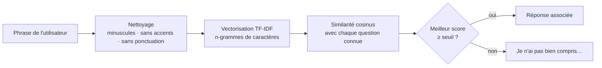

<div align="center">

# 🤖 Agent Conv

**Un agent conversationnel français, texte et voix, construit avec TF-IDF et similarité cosinus.**


Projet **SIA 417** · Faculté des Sciences · Université de Douala (Cameroun)

</div>

---

## ✨ Aperçu

```text
Vous : salu, ca va ?
Bot  : Je vais très bien, merci ! Tout va bien de ton côté ?      [score 0.76]

Vous : qui es-tu ?
Bot  : Je suis un agent conversationnel basé sur TF-IDF, créé dans le cadre du projet SIA 417.

Vous : quelle est la capitale du Cameroun ?
Bot  : Je n'ai pas bien compris, peux-tu reformuler ?              [score 0.30 < seuil 0.40]
```

L'agent **ne devine pas** : quand aucune question connue n'est assez proche, il le dit
au lieu d'inventer une réponse.

## 🎯 Fonctionnalités

- 💬 **Dialogue en français** : salutations, prise de nouvelles, remerciements, identité, aide
- 🔤 **Tolérant aux fautes** : « salu », « ca va », « au revoir » / « au-revoir » sont compris
- 🛡️ **Seuil de confiance** : refuse poliment les sujets hors de son domaine
- 🎲 **Réponses variées** : plusieurs réponses possibles pour une même question
- 🎙️ **Mode vocal (facultatif)** : reconnaissance vocale et lecture des réponses à voix haute
- 🧪 **Testé** : 18 tests automatisés + script d'évaluation chiffré

## 🧠 Comment ça marche



Il n'y a **pas d'entraînement supervisé** : c'est une *recherche par similarité*. Le
vectoriseur est ajusté en quelques millisecondes au démarrage à partir de
[`data/dataset.csv`](data/dataset.csv) (115 paires question → réponse, 7 catégories).

## 🚀 Installation

```bash
git clone https://github.com/<ton-pseudo>/agent-conversationnel-tfidf.git
cd agent-conversationnel-tfidf

python -m venv .venv
source .venv/bin/activate          # Windows : .venv\Scripts\activate
pip install -r requirements.txt
```

Mode vocal (facultatif, micro requis) : `pip install -r requirements-voice.txt`

## ▶️ Utilisation

```bash
python -m chatbot chat              # console
python -m chatbot chat --debug      # affiche le score de similarité
python -m chatbot gui               # interface graphique Tkinter (texte + voix)
python -m chatbot chat --seuil 0.5  # seuil personnalisé
python -m chatbot chat --dataset mon_fichier.csv
```

Utilisation dans votre propre code :

```python
from chatbot import ChatEngine

moteur = ChatEngine.depuis_csv(seuil=0.4)
r = moteur.repondre("salut, ça va ?")
print(r.texte, r.score, r.comprise)
```

## 📊 Résultats

Évaluation sur 54 phrases écrites à la main, absentes du dataset
([`data/eval.csv`](data/eval.csv)) : 34 reformulations du domaine et 20 phrases
hors-sujet. Reproductible avec `python scripts/evaluate.py`.

| Configuration | Phrases du domaine bien traitées | Hors-sujet rejetés | Exactitude |
|---|:---:|:---:|:---:|
| TF-IDF sur les mots, seuil 0,3 | 94 % | 30 % | 70,4 % |
| TF-IDF sur les mots, seuil optimal (0,6) | 85 % | 85 % | 85,2 % |
| **TF-IDF n-grammes de caractères, seuil 0,40** | **88 %** | **95 %** | **90,7 %** |

Les trois lignes utilisent le même dataset et le même nettoyage : seules la vectorisation et le seuil changent.


> **Lecture du graphique.** Un seuil trop bas répond à tout, y compris à ce qu'il ne
> connaît pas ; un seuil trop haut refuse même des phrases valides. Le seuil 0,40 est le
> meilleur compromis sur ce jeu de test.
>
> ⚠️ Le jeu de test est petit et sert aussi à choisir le seuil : ces chiffres
> indiquent une tendance, pas une performance garantie.

## 🗂️ Structure du projet

```text
agent-conversationnel-tfidf/
├── chatbot/
│   ├── preprocessing.py   # nettoyage du texte
│   ├── engine.py          # TF-IDF + similarité cosinus + seuil
│   ├── cli.py             # interface console
│   ├── gui.py             # interface Tkinter + voix
│   └── __main__.py        # python -m chatbot
├── data/
│   ├── dataset.csv        # questions, réponses, catégorie
│   └── eval.csv           # jeu d'évaluation
├── scripts/evaluate.py    # métriques + courbe du seuil
├── tests/                 # 18 tests pytest
└── docs/                  # rapport, présentation, images
```

## ⚠️ Limites

- Ne comprend que le **français** et un **nombre restreint de sujets** (conversation courante)
- Les réponses sont **choisies**, pas générées
- Le TF-IDF ne capture pas le sens : « je suis triste » et « je suis content » se ressemblent

## 🛣️ Pistes d'amélioration

- [ ] Remplacer TF-IDF par des *embeddings* de phrases (sens, multilingue)
- [ ] Étendre le dataset (questions pratiques, école, culture générale)
- [ ] Mémoire de conversation (contexte entre les messages)
- [ ] Interface web (Streamlit ou Flask)

## 📚 Documents du projet

- 📄 [Rapport de travail](docs/rapport.docx)
- 🖼️ [Présentation](docs/presentation.pptx)

## 👥 Auteurs

- **Tangou Ntchanga Yvan**
- **Chiakoua Nzukoue Rabelly**

Superviseur : **Dr Justin Moskolai** · Université de Douala · 2026

## 📄 Licence

Distribué sous licence [MIT](LICENSE).
